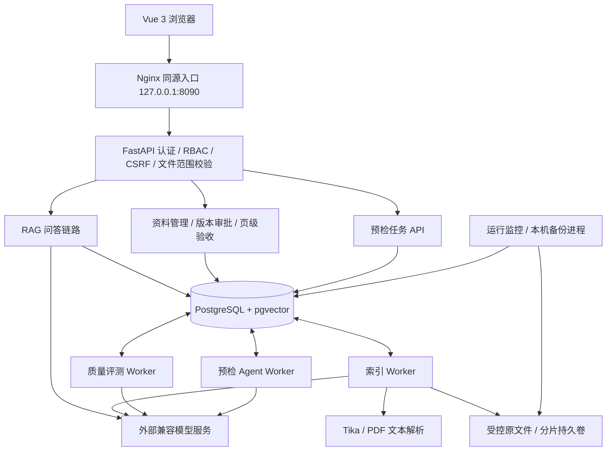

# 架构与模块职责

## 1. 技术定位

后端为 Python/FastAPI、SQLAlchemy、PostgreSQL/pgvector；前端为 Vue 3/Vite，流式回答使用 SSE。模型服务使用 OpenAI 兼容协议，分别完成聊天生成、Embedding 和 Agent 原生工具调用。

当前没有使用 LangGraph、Celery、Redis 或 Kubernetes，不应在项目介绍中虚构这些框架。任务状态机、队列与租约由项目代码及 PostgreSQL 实现；`ops_agent` 是监控/备份调度进程，不是另一个大模型Agent。

## 2. 三条核心数据流

### 知识入库

上传/分片续传 → 校验文件大小、格式和SHA-256 → 保存原件及文件记录 → 持久化索引队列 → 独立Worker解析、结构化切分、批量Embedding → 事务内更新向量与处理状态。

来源元数据关联文件ID、来源、物理页、片段及版本配置。PDF风险页单独保存质量记录，页面审核状态参与后续检索和发布门禁。特定说明书的表格/公式修复是源哈希绑定的有限配置，不是通用OCR。

### RAG 问答

用户选择获授权的已发布文件 → 核验文件范围/会话版本 → 必要的追问消解和子问题拆分 → 查询向量化 → 向量与词项双路候选召回 → 排名融合与相关性筛选 → 构建证据上下文 → 兼容模型生成 → SSE输出正文和来源 → 保存成功轮次。

- 向量通道使用 pgvector 余弦距离，表上有 HNSW 索引。
- 词项通道使用 `ILIKE` 匹配与 `pg_trgm` 索引，按命中词项计数等排序；不是BM25。
- 双路按 `1/(60+rank)` 倒数排名融合，再结合型号匹配、距离、问题主题和PDF片段评分筛选；不是训练过的Cross-Encoder重排器。
- 权限、发布状态、指定文件及PDF页级限制同时用于两路查询，不能靠关键词通道绕过范围。
- 历史用户问题可辅助指代消解；历史AI回答不作为事实证据。拒答阈值及规则仍需扩大评测。

### 送审预检 Agent

目标+固定资料ID → 建立持久化任务 → Worker按租约领取 → 模型每轮选择一个白名单工具 → 服务端执行并记录结果 → 根据结果继续、等待或结束。

可调用：处理状态、索引完整性、解析质量、评测结果、经授权启动评测、等待、请求送审确认、生成报告。不提供批准、发布、删除、任意SQL或Shell工具。

草稿基础检查通过后进入 `awaiting_confirmation`；仅用户确认才送审。已送审但无有效报告时，只有获得费用授权的管理员任务能启动评测。最终报告由服务端重查四项证据生成，不接受模型自称通过。

## 3. 模块映射

| 职责 | 主要实现 |
|---|---|
| 认证、角色与文件可见范围 | `backend/app/auth.py`、`access.py` |
| 文件、分片上传、格式解析和切分 | `main.py`、`resumable_upload.py`、`documents.py`、`splitter.py` |
| 检索、索引与片段筛选 | `knowledge.py`、`pdf_rerank.py` |
| 版本切换、PDF验收及发布门禁 | `versioning.py`、`pdf_quality.py`、`release_quality.py` |
| 持久化索引/评测任务 | `task_queue.py`、`quality_queue.py`、`worker.py` |
| Agent工具编排与独立执行 | `precheck_agent.py`、`precheck_worker.py` |
| 业务页面与状态同步 | `frontend/src/App.vue`、`PrecheckPanel.vue`、`agentTask.js` |
| 单机部署 | `compose.staging.yml`、`deploy/` |

## 4. 可靠性与安全边界

PostgreSQL保存任务状态、轮次、claim token和租约；过期可重新领取，旧租约不能补写。外部模型调用不与数据库事务构成分布式事务，崩溃重试可能重复计费，不能称“严格exactly-once”。

Agent上限为24轮选择、3次累计错误、24小时任务有效期；每账号24小时最多10个新任务、系统最多20个活跃任务。这是数量与时长限制，不是精确货币预算。

默认必须独立审批人。本地当前已开启单管理员例外，要求显式确认和至少5字原因，并留专项日志；PDF与质量门禁不豁免。部署来源不符合本机HTTP限制时不能开启此选项。正式上线必须关闭并进行额外安全审查。

Agent报告与资料身份、索引、题库、模型、页审核和发布基线绑定；相关状态变化后 `current=false`，旧结论只供追溯。`ready`不等于已发布，发布后的旧预检变为过期也不代表曾经执行失败。
